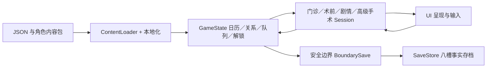

# 星见医院：新会话上下文

固化日期：2026-11-07。范围：当前可见会话、现行工作区、已有设计／验收记录和本机项目 Skills。它是接续开发的入口，不是完整聊天备份；不能保证还原没有提供的旧会话。规则先读 [AGENTS.md](../AGENTS.md)，工作方法读 [skills/README.md](skills/README.md)。

## 世界观与产品方向

《星见医院 · 春日序章》是日式 2D 医院生活模拟 × Visual Novel × 成人向角色关系沙箱。医院日常本身就是主线，重视自由、可扩展和重复游玩；不擅自加入强制悬疑主线。另存的 CORE 医学伦理悬疑 VN 属未来独立方向，不是当前隐藏主线。

核心基调是“看起来像青春社团，工作起来像真正医院”：温暖、轻松、专业与荒诞并存；医护可以闹，但关键时刻可靠。医疗失败与危机优先承担救场、代价和成长功能；具体剧情仍以作者原稿为准，不用风格概述改写已提供文本。详见 [世界观指南](design/HOSHIMI_HOSPITAL_TONE_WORLDVIEW_FESTIVAL_GUIDE.md)、[围术期与手术室规范 V1.2](design/HOSHIMI_1995_2005_OR_PERIOPERATIVE_WORLDVIEW_V1_2.md)、[设计目录](design/README.md)。

主角为坂口隆司（坂口是姓，隆司是名；职业称呼“坂口医生”）。`data/characters/protagonist.json` 记录海外研修、导师推荐、12 个月合同与最初临时落脚的意图。归属感是长期主题；具体职级不能从旧草案擅自定案。引擎显示版本仍为 `0.1.0`，不能据此把已经扩展的工程误认为只有初始病例。

## 核心循环及系统关联

1. 医院导览和日历决定地点、时段、人员在场与预约。工作日起点 09:00、正常班次 480 分钟；当前 GameState 设门诊截止 16:00、365 日周期。加班、跨日和预约由具体接口结算，不用场景画面时钟回推总耗时。
2. 门诊从患者包与病例模板建立 Encounter：问诊、查体、检查、诊断、沟通、住院或合法转诊。随机池模板可重复出现，不等于建立跨次永久患者病史；剧情患者与医护患者有独立注册和事实。
3. 住院进入共享 Preop：探视、病房护士、团队、护理、更衣／刷手、术式与麻醉确认，再进入普通手术。团队岗位与熟人关系影响可选成员，患者性格及专属覆盖影响表现，流程逻辑仍共享。
4. 手术结算关联已消耗时间、主角能力、医护成长、熟悉度、术式解锁与质量记录。高级手术使用独立 Model/Session，复用日历、队伍、生理和结算接口；病例板、预约、首通与冷却通过稳定事实衔接。
5. 日常、微事件、约会、下班同行、专属护士和人物里程碑构成长期关系。认识 `met` 与羁绊等级分开；熟悉度 0–100，隐藏好感独立；Lv1–Lv5 由作者事件结算，不靠熟悉度自动升满。每个事件有自己的门槛与冷却。
6. Lv4 固定剧情可能授予亲密资格，但重复互动必须另有 registry、Profile/Flow/Context、资源和预约流程。Lv5 医护患者同样需要真实完成事实、角色配置、对白与素材；不能只改等级数值开通。
7. 画廊／回想与白日梦有自己的内容与读过／完成事实；回想不能再次发奖励。所有演出内部节点与播放状态只留内存。最终回到医院导览或周日安全边界才允许存档。

各 Session 可有运行时快照，但它不是上图持久文件契约。现行为 v37 `boundary_facts_v1`；v36 仅迁移可可靠提取的事实，v35 及更早不自动导入。恢复不能重放剧情或重发奖励，不能按现行剧本重算过去的分钟。详见 [存档契约](save_boundary_v37.md)。

## 已落地模块与证据地图

下表的“已有”表示仓库存在实现及对应记录／测试入口，不表示本次重新运行通过，也不表示每个角色全部完成。

| 模块 | 已有实现 | 接续入口／证据 |
|---|---|---|
| 工程、加载与本地化 | 主场景、只读 manifest、角色／患者包、Schema、中英文本 | `project.godot`、`godot/scripts/content_loader.gd`、[架构](architecture.md)、[本地化](localization.md) |
| 门诊与随机患者 | 病例、问诊检查、诊断、病历、住院、队列及转诊 | `encounter_session.gd`、`game_state.gd`、[患者接入](adding_random_patient.md) |
| 术前与普通手术 | 编队、护理、麻醉、术中阶段／互动、危机与结算 | `preop_session.gd`、[术式目录](surgery_catalog.md)、[成长与解锁](surgery_progression_implementation.md) |
| 主角和长期成长 | 技术、领导力、魅力、声望、临床气场及结算历史 | `progression_config.gd`、[主角属性](player_attributes.md) |
| 关系与在场 | 相识、羁绊、熟悉度、角色事件、微事件、岗位、日历 | `presence_resolver.gd`、`fixed_calendar.gd`、[关系](relationship_rank_system.md) |
| 专属护士／下班同行／周日 | 专用状态、日程与表现接口 | [专属护士现状](HOSHIMI_PERSONAL_NURSE_SYSTEM_CURRENT.md)、[同行现状](HOSHIMI_AFTER_WORK_WALK_IMPLEMENTATION_CURRENT.md)、[周日约会](sunday_date_rules.md) |
| 固定剧情和演出 | Character／Special／Micro Session，背景、CG、说话人、分页及回想 | `character_event_session.gd`、`special_event_session.gd`、[场景上下文](scene_content_context.md) |
| 重复亲密流程 | Registry、适配器、Profile/Flow/Context、热区及预约 | [Profile 实现](h_profile_v1_implementation.md)、[排程](free_h_scheduling_v1_1.md)、`free_h_registry.gd` |
| 医护作为患者 | 独立患者注册、称呼上下文、共享普通流程、高级患者事实 | `staff_patient_registry.gd`、[清单](staff_as_patient_checklist.md)、[高级患者接入](advanced_staff_patient_integration_2026-11-01.md) |
| 高级手术／转诊 | Model、Session、生理、团队、术式对白、病例板及跨日结算 | [原型记录](advanced_surgery_prototype_2026-10-30.md)、[转诊规则](advanced_referral_rules_v2_implementation_2026-11-01.md)、`advanced_*` 系统与测试 |
| 白日梦及惠惠内容 | 独立 catalog、UI、稳定阅读事实和专项事件模块 | [白日梦](daydream_mode_implementation_2026_11_02.md)、[惠惠记录](megumin_implementation_report_2026_11_05.md) |
| 存档 | 八槽、原子写入、安全边界事实格式、迁移与内存快照隔离 | `boundary_save.gd`、`save_store.gd`、[v37](save_boundary_v37.md) |
| 导出验证工具 | 导出预设与检查工具已存在 | [导出验证](export_validation.md)、`tools/export_release_checked.py`；不等于各平台发行已验收 |

表中无目录前缀的 `.gd` 系统文件位于 `godot/systems/`。详细设计与实现差异不能仅靠表格判断，先读对应现状记录，再读代码。

## 当前工作区接续重点

本次开始时工作区已有大量未提交内容：成美／七瀬恋 Lv1 修订、共享 Lv2／Lv3、成美 Lv4 和 H 包、美幸 Lv5 V5.2 的原稿、翻译、素材替换、导入器与测试，以及 GameState/UI/Schema 等改动。它们是用户已有工作，不能 `reset`、清理或当作本次文档成果；是否最终完成必须以原稿、加载链和最新报告复核。

- 成美 `doc_aoi` 的 Free H 在当前 registry 明确为 `pending_assets`。存在 Profile/Flow 或固定 Lv4 数据不等于正式可预约。
- 芹香 `doc_serika`、美幸 `nurse_yui` 的 registry 为 `ready`；小夜香 `doc_sayaka` 有独立兼容适配器。此处是静态注册事实，本次未重新实机验证。
- 旧 `TODO.md` 仍有“新 Lv1 待设计”“微事件调度待接”等阶段性条目；不要用它覆盖当前文件。旧 README 的事件中途存档描述已被现行规则取代。
- `docs/qa/` 和 `reports/` 的旧通过记录仅证明当时版本及实际覆盖路径。素材替换、剧本版本变化后不能沿用旧截图作新版本验收。
- 美术许可、发布授权与平台实测独立于本地可运行状态。没有新授权，不因整理文档执行上传、发布或生成素材。

## 角色身份索引

以下由 `data/staff/index.json` 指向的 profile 枚举。该集合也包含剧情患者／来宾，不代表所有记录都是可编队员工。保留技术 ID；身份、职业、年龄以当前 profile 及专用注册数据为准，不从外观、旧名称或其他作品推断。

| 稳定 ID | 当前显示姓名 |
|---|---|
| `doc_aoi` | 神宮寺 成美 |
| `doc_rei` | 深山 佳織 |
| `nurse_haru` | 七瀬 恋 |
| `nurse_rin` | 中井 美佳 |
| `nurse_yui` | 朝倉 美幸 |
| `pharmacist_manami` | 飯村 真奈美 |
| `nurse_ange` | 利根川 安琪 |
| `nurse_hiroko` | 杉村 弘子 |
| `nurse_moe` | 本庄 萌惠 |
| `doc_emiko` | 御堂 江美子 |
| `doc_asuka` | 城宮 明日香 |
| `doc_artoria` | 阿尔托莉雅·潘德拉贡 |
| `doc_shiori` | 藤崎 詩織 |
| `doc_aqua` | 水城 阿库娅 |
| `doc_sayaka` | 南条 小夜香 |
| `doc_minato` | 遥凑 |
| `visiting_maya` | 伊吹 摩耶 |
| `visiting_futaba` | 佐仓 双叶 |
| `nurse_ishigami` | 石神 千鹤 |
| `doc_sakura_anesthesiology` | 樱花 |
| `nurse_satsuki` | 折川 皐月 |
| `nurse_iwasaki_rumi` | 岩崎留美 |
| `nurse_yoneda_shiori` | 米田栞 |
| `nurse_sonoda_itsumi` | 薗田愛実 |
| `nurse_kariya_megumi` | 狩谷惠 |
| `nurse_hikami_saeko` | 氷上冴子 |
| `doc_serika` | 御園芹香 |
| `doc_takemi` | 武見妙 |
| `patient_chihaya` | 仓本千早 |
| `guest_mizuho` | 支手瑞穗 |

## 新会话最短接手步骤

1. 读根规则、本文件和工作流索引；执行 `git status --short`。
2. 确认角色／术式／事件稳定 ID，找到 index → bundle → JSON → registry/session → UI 的实际加载链。
3. 找到用户最终原稿、译稿和素材映射；多个 V2/V4/V5 文件并存时核对导入器、记录和当前要求，不按文件名最大值猜。
4. 阅读相应工作流与测试脚本，说明已有证据、待确认内容和本次授权范围。
5. 在本次范围内修改与验证，交付实际结果；同时更新对应现状文档，保留原稿和历史证据。

没有出现在以上来源中的聊天决定属于未知。应提出具体缺口，不能为了“恢复全部记忆”推测创作决定、解锁条件或已完成状态。
